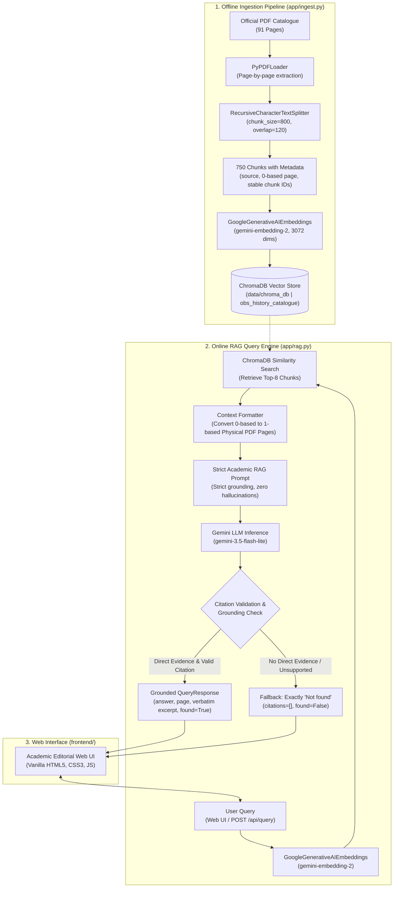

# Orient BlackSwan History Catalogue RAG Bot

An academic Retrieval-Augmented Generation (RAG) system built to query the official **Orient BlackSwan History 2024–25 Catalogue** ([`History_2024-25.pdf`](https://www.orientblackswan.com/pdfs/downloads/History_2024-25.pdf)).

The system is strictly grounded on the catalogue content: it provides 1-indexed physical PDF page citations with verbatim supporting excerpts for verifiable facts, and falls back to **`"Not found"`** whenever a query is ungrounded, subjective, or outside the catalogue scope.

---

## 🏗️ System Architecture & End-to-End Flow

### High-Level Architecture Flowchart



### Detailed Pipeline Stages

1. **Ingestion & Indexing:**
   - **Document Extraction:** The 91-page PDF catalogue is loaded via `PyPDFLoader`, capturing text and 0-based page metadata per page.
   - **Deterministic Chunking:** `RecursiveCharacterTextSplitter` segments text into chunks of 800 characters with a 120-character overlap. Each chunk receives a deterministic, stable ID (`<filename>:p<page>:c<chunk_index>`).
   - **Embeddings:** Chunks are vectorized using Google's `gemini-embedding-2` model (3072 dimensions).
   - **Storage:** Persisted into a local ChromaDB collection (`obs_history_catalogue`) in `data/chroma_db/`. Total chunks indexed: **750**.
2. **Retrieval & Context Formation:**
   - For an incoming query, query embeddings are generated using the identical `gemini-embedding-2` model.
   - The top $k=8$ most relevant passages are retrieved from ChromaDB.
   - The engine converts the 0-based page index to the **physical 1-based page number** (`page_num = doc.metadata["page"] + 1`) and annotates each passage.
3. **Inference & Grounding Guardrails:**
   - The context is injected into a strict academic prompt forbidding external world knowledge, speculation, or subjective claims.
   - The LLM (`gemini-3.5-flash-lite`) outputs structured JSON.
   - **Excerpt Verification:** Extracted citations are cross-checked against the raw text of the retrieved chunks. If an excerpt is not present in the retrieved passages, or if no evidence exists, the response immediately falls back to `{"answer": "Not found", "citations": [], "found": false}`.

---

## 📋 The Five Assessment Questions & Live Results

Below are the live, verified answers and citations generated by the RAG pipeline across the five evaluation queries.

---

### Question 1: Catalogue Price Update Date
> **Question:** *"On what date were the prices in this catalogue last updated?"*

- **Status:** `found: true`
- **Answer:** The prices in the catalogue were last updated on 20-01-2025.
- **Citations:**
  - **Physical PDF Page:** `Page 91` (and `Page 2`)
  - **Supporting Excerpt:** `"Prices updated on 20-01-2025."`
- **Latency:** ~2.4 seconds

```markdown
<!-- SCREENSHOT PLACEHOLDER: Question 1 -->
<!-- Replace the path below with your screenshot of Question 1 and its answer -->

```

---

### Question 2: Orient BlackSwan Incorporation Year
> **Question:** *"In which year was Orient BlackSwan incorporated?"*

- **Status:** `found: true`
- **Answer:** Orient BlackSwan was incorporated in 1948.
- **Citations:**
  - **Physical PDF Page:** `Page 2`
  - **Supporting Excerpt:** `"Incorporated in 1948, the consistent emphasis of our publishing programme has been on quality."`
- **Latency:** ~2.1 seconds

```markdown
<!-- SCREENSHOT PLACEHOLDER: Question 2 -->
<!-- Replace the path below with your screenshot of Question 2 and its answer -->

```

---

### Question 3: Physics Textbook Price (Out-of-Scope Discipline)
> **Question:** *"What is the price of a Physics textbook?"*

- **Status:** `found: false`
- **Answer:** **`Not found`**
- **Citations:** `[]`
- **Grounding Explanation:** The catalogue exclusively covers Orient BlackSwan's History list (2024–25). It does not contain listings or pricing for physics textbooks. The system strictly refuses to speculate.

```markdown
<!-- SCREENSHOT PLACEHOLDER: Question 3 -->
<!-- Replace the path below with your screenshot of Question 3 and its answer -->

```

---

### Question 4: Current Minister of Education (External World Knowledge)
> **Question:** *"Who is the current Minister of Education?"*

- **Status:** `found: false`
- **Answer:** **`Not found`**
- **Citations:** `[]`
- **Grounding Explanation:** Current government officeholders are external world knowledge not stated anywhere within the bibliographic catalogue. The pipeline suppresses general LLM knowledge and returns `"Not found"`.

```markdown
<!-- SCREENSHOT PLACEHOLDER: Question 4 -->
<!-- Replace the path below with your screenshot of Question 4 and its answer -->

```

---

### Question 5: "Best" History Book for a Beginner (Subjective Claim)
> **Question:** *"Which is the "best" history book for a beginner?"*

- **Status:** `found: false`
- **Answer:** **`Not found`**
- **Citations:** `[]`
- **Grounding Explanation:** The catalogue is an academic bibliography and does not declare any single title as "the best book for a beginner." Because subjective recommendations are unsupported by verifiable catalogue facts, the system correctly falls back to `"Not found"`.

```markdown
<!-- SCREENSHOT PLACEHOLDER: Question 5 -->
<!-- Replace the path below with your screenshot of Question 5 and its answer -->

```

---

## 🛠️ Tech Stack & Model Selection

| Component | Technology | Rationale / Notes |
| :--- | :--- | :--- |
| **Backend Framework** | [FastAPI](https://fastapi.tiangolo.com/) + [Uvicorn](https://www.uvicorn.org/) | High-performance async ASGI server with native Pydantic validation. |
| **Vector Store** | [ChromaDB](https://www.trychroma.com/) (`langchain-chroma`) | Embedded persistent vector database storing 750 chunks locally. |
| **Embedding Model** | Google Gemini `gemini-embedding-2` | 3072-dimensional embeddings. Configured for both document indexing and query retrieval. (Replaces retired `text-embedding-004`). |
| **LLM Inference** | Google Gemini `gemini-3.5-flash-lite` | High throughput, sub-2.5s response latency, free-tier compatibility, zero reasoning-delay overhead. |
| **Document Processing**| `PyPDFLoader` + `RecursiveCharacterTextSplitter` | Preserves source document metadata and 0-based page numbering. |
| **Frontend** | Vanilla HTML5 / CSS3 / JavaScript | Responsive, lightweight academic editorial interface with zero external dependencies. |
| **Testing** | [Pytest](https://docs.pytest.org/) + [HTTPX](https://www.python-httpx.org/) | Full suite covering unit tests, embedding smoke tests, health checks, and live RAG integration. |

---

## 📂 Project Structure

```text
Orient BlackSwan History Bot/
├── app/
│   ├── __init__.py           # Package marker
│   ├── main.py               # FastAPI server, health check & query API
│   ├── rag.py                # RAG engine, ChromaDB retrieval, prompt & citation validation
│   └── ingest.py             # PDF downloader, chunker & Gemini vector indexing pipeline
├── frontend/
│   ├── index.html            # Academic search interface
│   ├── style.css             # Vanilla CSS academic design system
│   └── script.js             # API client, sample query chips & DOM renderer
├── data/
│   ├── History_2024-25.pdf   # 91-page catalogue source document
│   └── chroma_db/            # Persistent ChromaDB vector database (750 chunks)
├── tests/
│   ├── __init__.py           # Test package marker
│   ├── test_embedding_smoke.py # Minimal live Gemini embedding smoke test
│   ├── test_health.py        # Health endpoint & scaffold tests
│   ├── test_ingest.py        # Ingestion pipeline unit & integration tests
│   ├── test_rag_live.py      # Live end-to-end regression tests for the 5 questions
│   └── test_rag_unit.py      # Citation validation & physical page conversion unit tests
├── .env                      # Local environment configuration (API key & model settings)
├── .env.example              # Template configuration
├── .gitignore                # Excludes secrets, vector store, and virtual environments
├── requirements.txt          # Python dependencies
└── README.md                 # Complete documentation & walkthrough
```

---

## 🚀 Setup & Execution Guide

### 1. Prerequisites
- Python 3.10+ (tested on Python 3.10 – 3.14)
- Google Gemini API Key ([Google AI Studio](https://aistudio.google.com/))

### 2. Virtual Environment Setup

```bash
# Clone or navigate to the project directory:
cd "Orient BlackSwan History Bot"

# Create a virtual environment:
python3 -m venv venv

# Activate the virtual environment:
# On macOS / Linux:
source venv/bin/activate
# On Windows:
venv\Scripts\activate

# Install dependencies:
pip install -r requirements.txt
```

### 3. Environment Configuration

Create a `.env` file from `.env.example`:

```bash
cp .env.example .env
```

Ensure `.env` contains:

```env
# Google Gemini API Key
GEMINI_API_KEY=your_actual_gemini_api_key_here

# Source Document Configuration
PDF_URL=https://www.orientblackswan.com/pdfs/downloads/History_2024-25.pdf
PDF_LOCAL_PATH=data/History_2024-25.pdf

# Vector Database (ChromaDB) Configuration
CHROMA_PERSIST_DIRECTORY=data/chroma_db
CHROMA_COLLECTION_NAME=obs_history_catalogue

# Model Settings
EMBEDDING_MODEL=gemini-embedding-2
LLM_MODEL=gemini-3.5-flash-lite

# Application Server Settings
HOST=127.0.0.1
PORT=8000
DEBUG=True
```

---

### 4. Running the Ingestion Pipeline

To build or refresh the ChromaDB vector index from the PDF catalogue:

```bash
# Full ingestion (downloads PDF if needed, chunks, embeds with gemini-embedding-2, and persists):
python -m app.ingest

# Dry-run mode (verifies PDF parsing and chunking without calling the Gemini API):
python -m app.ingest --dry-run
```

**Ingestion Output:**
- 91 PDF pages extracted.
- 750 chunks generated with deterministic IDs.
- Stored in `data/chroma_db` under collection `obs_history_catalogue`.

---

### 5. Running the Application Server

Start the FastAPI application with Uvicorn:

```bash
uvicorn app.main:app --host 127.0.0.1 --port 8000
```

- **Web Application:** [http://127.0.0.1:8000/](http://127.0.0.1:8000/)
- **Interactive Swagger Docs:** [http://127.0.0.1:8000/docs](http://127.0.0.1:8000/docs)
- **Health Check Endpoint:** [http://127.0.0.1:8000/api/health](http://127.0.0.1:8000/api/health)

---

### 6. Running Automated Tests

Run the complete test suite using `pytest`:

```bash
pytest tests/
```

**Test Coverage (19 tests passed):**
- `tests/test_health.py`: Verifies FastAPI routes, static file serving, and `/api/health`.
- `tests/test_embedding_smoke.py`: Validates `gemini-embedding-2` vector generation and dimensionality.
- `tests/test_ingest.py`: Tests downloader, PyPDFLoader extraction, chunker bounds, and Chroma indexing.
- `tests/test_rag_unit.py`: Tests 0-based to 1-based page conversion and verbatim citation excerpt verification.
- `tests/test_rag_live.py`: Tests all 5 evaluation questions live against the persistent ChromaDB index and Gemini API.

---

## 📡 API Reference

### Health Status
`GET /api/health`

**Response (200 OK):**
```json
{
  "status": "ok",
  "app": "Orient BlackSwan History Catalogue RAG Bot",
  "version": "0.1.0",
  "checks": {
    "gemini_api_key_configured": true,
    "catalogue_pdf_present": true,
    "vector_database_indexed": true
  },
  "pdf_source": "https://www.orientblackswan.com/pdfs/downloads/History_2024-25.pdf",
  "message": "Orient BlackSwan History Bot scaffold is operational."
}
```

### Query Catalogue
`POST /api/query`

**Request Body:**
```json
{
  "question": "In which year was Orient BlackSwan incorporated?"
}
```

**Response (200 OK - Found):**
```json
{
  "question": "In which year was Orient BlackSwan incorporated?",
  "answer": "Orient BlackSwan was incorporated in 1948.",
  "citations": [
    {
      "page": 2,
      "excerpt": "Incorporated in 1948, the consistent emphasis of our publishing programme has been on quality."
    }
  ],
  "found": true,
  "model": "gemini-3.5-flash-lite"
}
```

**Response (200 OK - Not Found):**
```json
{
  "question": "What is the price of a Physics textbook?",
  "answer": "Not found",
  "citations": [],
  "found": false,
  "model": "gemini-3.5-flash-lite"
}
```
